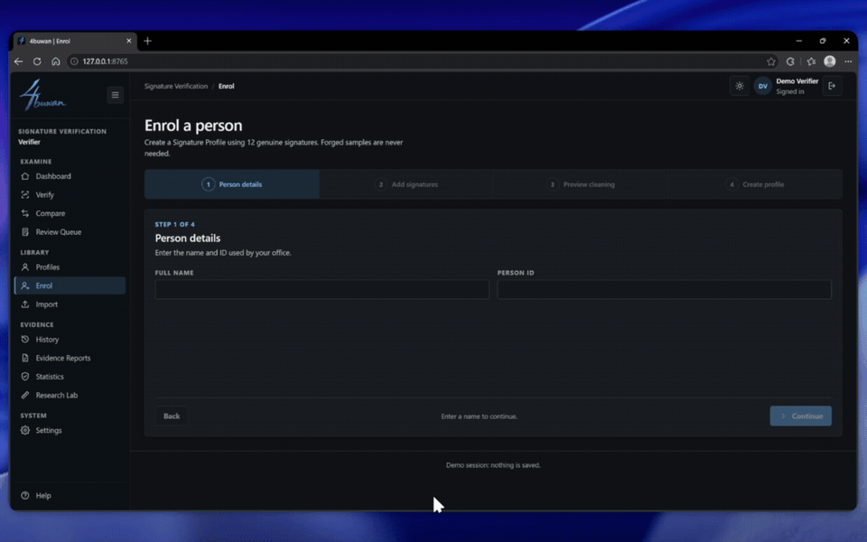
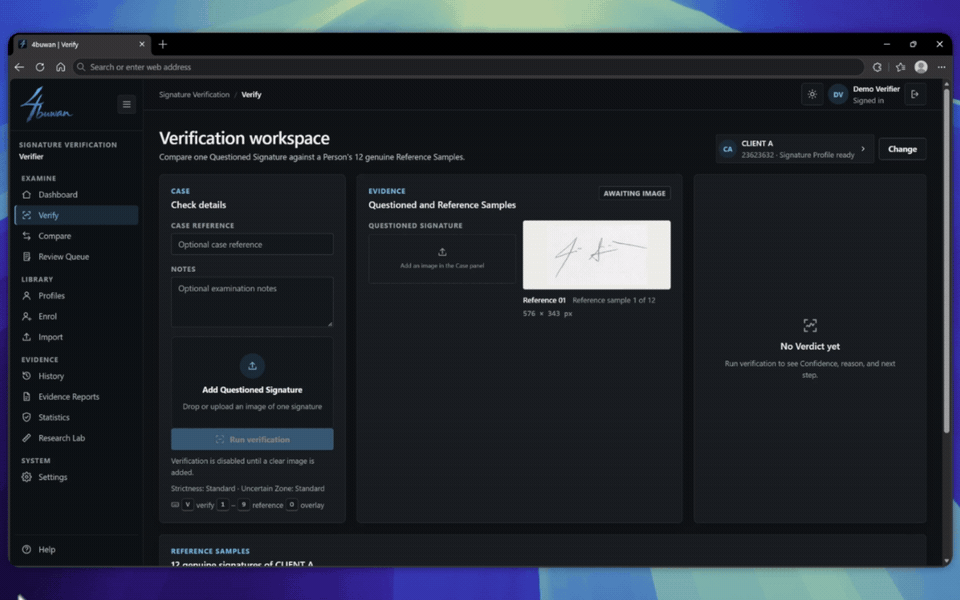
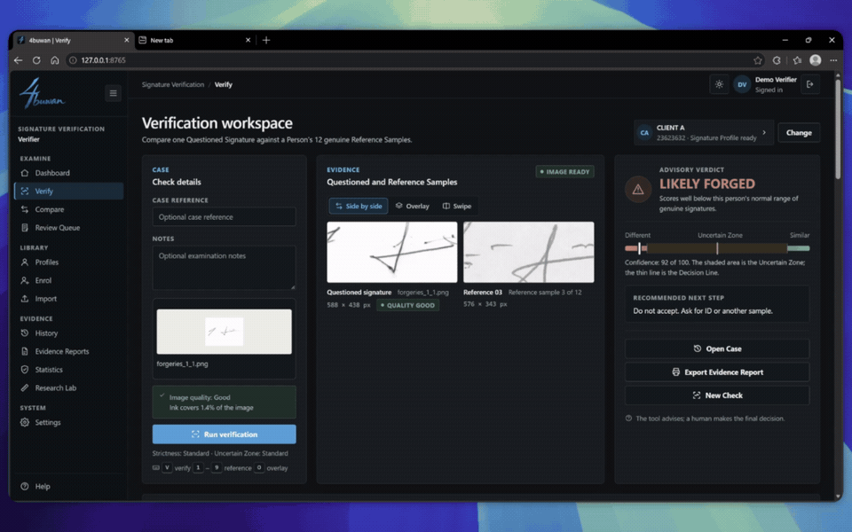
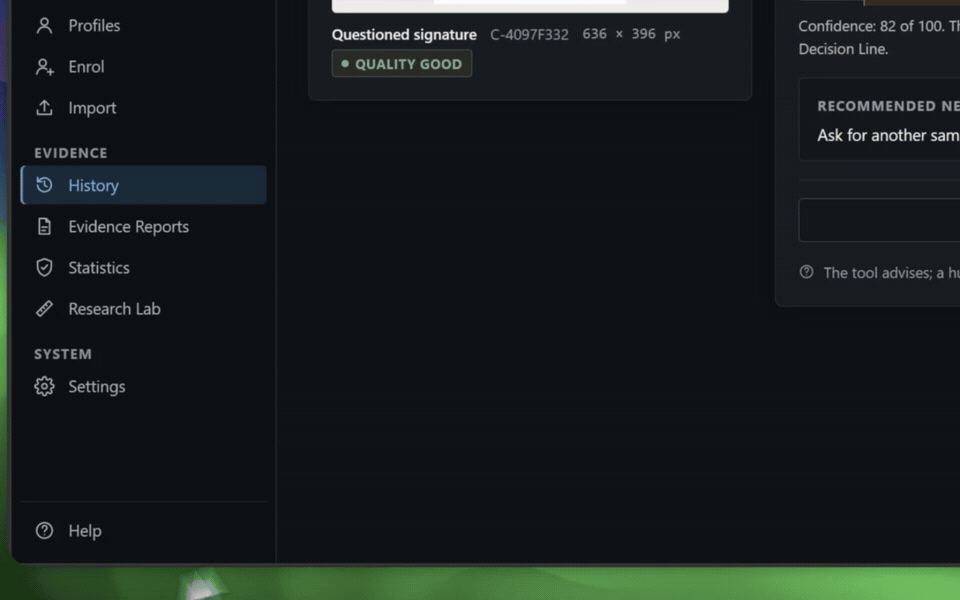
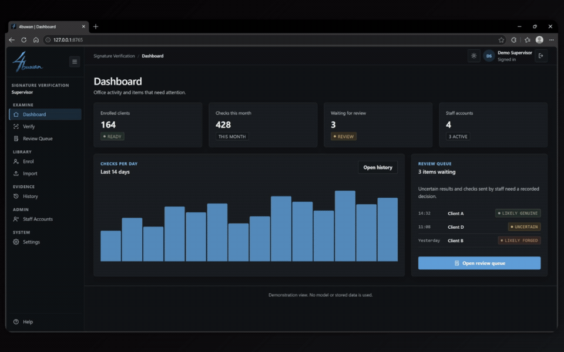
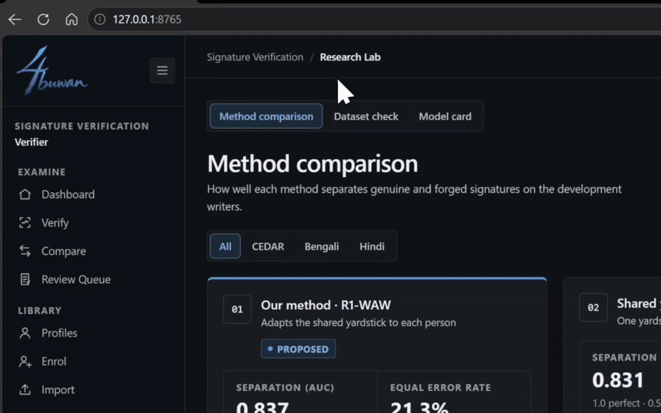
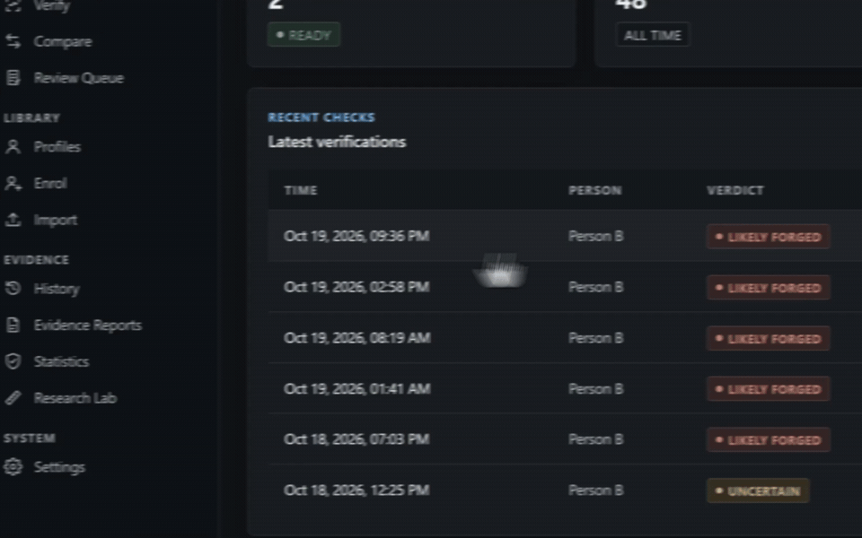

<h1 align="center">
   4buwan
</h1>

  
  
  

  <a href="../../README.md">English</a> · <a href="README.zh-CN.md">中文</a> · <a href="README.ja.md">日本語</a> · <a href="README.ko.md">한국어</a> · Español · <a href="README.fr.md">Français</a> · <a href="README.pt.md">Português</a> · <a href="README.tl.md">Tagalog</a>

  <strong>Verificación de firmas solo a partir de muestras genuinas.</strong> 
  Un espacio de examen para decisiones claras y evidencia verificable.

  

## Funciones del sistema

<table>
<tr>
<td width="50%" valign="middle">

### Inscripción solo con firmas genuinas

Doce firmas genuinas crean un perfil, y cada una pasa un control de calidad al llegar. Nunca hacen falta falsificaciones.

[Video completo →](../mp4/Genuine-Only%20Enrolment.mp4)

</td>
<td width="50%">
  
</td>
</tr>
<tr>
<td width="50%" valign="middle">

### Verificación adaptada a cada persona

R1-WAW ajusta una medida compartida a la variación propia de cada persona y da un veredicto orientativo con zona incierta.

[Video completo →](../mp4/Writer-Adaptive%20Verification.mp4)

</td>
<td width="50%">
  
</td>
</tr>
<tr>
<td width="50%" valign="middle">

### Evidencia inspeccionable

Cada veredicto muestra su razonamiento: la puntuación frente a la línea de decisión, las 12 comparaciones, las 17 medidas y la matriz de similitud.

[Video completo →](../mp4/Inspectable%20Evidence.mp4)

</td>
<td width="50%">
  
</td>
</tr>
<tr>
<td width="50%" valign="middle">

### Informes de evidencia imprimibles

Con un clic, un caso se convierte en un informe listo para archivar: la firma cuestionada, las 12 referencias, el veredicto y la puntuación. Imprímelo o guárdalo como PDF.

[Video completo →](../mp4/Printable%20Evidence%20Reports.mp4)

</td>
<td width="50%">
  
</td>
</tr>
<tr>
<td width="50%" valign="middle">

### Revisión con decisión humana

La herramienta aconseja, una persona decide. Las verificaciones inciertas esperan en una cola de revisión y cada decisión necesita un motivo.

[Video completo →](../mp4/Human%20Decision%20Review.mp4)

</td>
<td width="50%">
  
</td>
</tr>
<tr>
<td width="50%" valign="middle">

### Laboratorio de investigación y Comprobación de atajos

La tesis dentro de la app: comparación de métodos, comprobación de atajos del conjunto de datos y la ficha del modelo. Demuestra que el método lee la escritura y no el escáner. Cada resultado se contrasta con un control que solo ve datos simples de la imagen.

[Video completo →](../mp4/Research%20Lab.mp4)

</td>
<td width="50%">
  
</td>
</tr>
<tr>
<td width="50%" valign="middle">

### Panel de la oficina

Perfiles, verificaciones, tasa de inciertos y decisiones pendientes de un vistazo.

[Video completo →](../mp4/Office%20Dashboard.mp4)

</td>
<td width="50%">
  
</td>
</tr>
</table>

**También incluye:**

- **Comparar** — Examina de dos a seis firmas lado a lado.
- **Importar y exportar** — Carga un espacio de trabajo completo (personas, firmas, verificaciones y decisiones) desde un solo archivo.
- **Historial y exportación CSV** — Cada verificación, decisión y nota, con búsqueda.
- **Temas claro y oscuro** — Con un diseño que funciona del teléfono al escritorio.
- **Privado por diseño** — Las firmas se quedan en este ordenador.

---

## Funciones del modelo

Verificación offline de firmas dependiente del escritor. Cada escritor se registra con **12 firmas genuinas y ninguna falsificación**.

### Método (resumen)

Las firmas se comparan por pares. Un modelo aprendido solo con los pares genuinos del escritor puntúa una firma cuestionada frente a las 12 referencias. El núcleo del método, **R1-WAW** (blanqueamiento adaptativo al escritor de rango uno), adapta a cada escritor una medida compartida por muchos escritores con un solo parámetro, de modo que 12 referencias bastan para ajustarlo.

La implementación no se publica: el motor de verificación se distribuye compilado (`backend/sigdesk_engine/engine.pyc`, Python 3.14).

### Conjuntos de datos

| Conjunto | Escritura | Escritores de desarrollo |
|---|---|---|
| CEDAR | Latina | 25 |
| BHSig260 Bengali | Bengalí | 45 |
| BHSig260 Hindi | Devanagari | 72 |

Registro: genuinas 1–12. Prueba: genuinas 13–24 y falsificaciones 1–12. 172 escritores se reservan para una única evaluación final.

### Resultados (conjunto de desarrollo, 142 escritores)

| Métrica | AUC | EER |
|---|---|---|
| B — Diagonal global | 0.772 | 25.8% |
| G — Covarianza completa agrupada | 0.831 | 22.0% |
| **J — Adaptativa al escritor de rango 1** | **0.837** | **21.3%** |

| Conjunto | J AUC | J EER |
|---|---|---|
| CEDAR | 0.839 | 21.3% |
| BHSig260 Bengali | 0.801 | 25.4% |
| BHSig260 Hindi | 0.858 | 18.8% |

Comparación pareada por escritor con pruebas de Wilcoxon, corrección de Holm e intervalos bootstrap. J frente a G: +0,006 de AUC (53 escritores mejoran, 13 empeoran, 76 sin cambios).

> **Estado:** borrador. Los resultados son solo de los escritores de desarrollo; la evaluación reservada aún no se ha ejecutado. En bengalí, un control basado en estadísticas de imagen iguala al modelo, por lo que esos resultados no se presentan como verificación de firmas.

---

## Licencia

4buwan es software libre y de código abierto bajo la [Licencia MIT](../../LICENSE).

