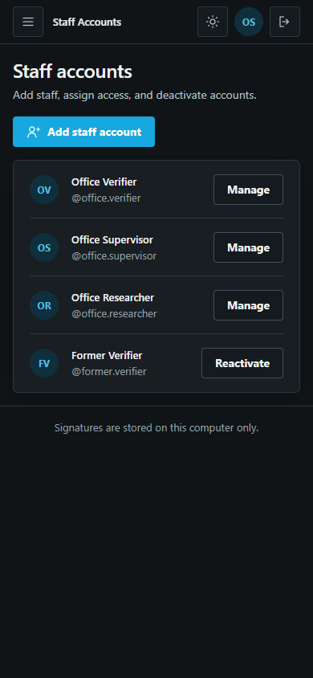

<h1 align="center">
   4buwan
</h1>

<p align="center">
  <a href="https://github.com/og-cz/4buwan"></a>
  <a href="https://github.com/og-cz/4buwan/releases"></a>
  
</p>

<p align="center">
  <sub><a href="../../README.md">English</a> · <a href="README.zh-CN.md">中文</a> · <a href="README.ja.md">日本語</a> · <a href="README.ko.md">한국어</a> · Español · <a href="README.fr.md">Français</a> · <a href="README.pt.md">Português</a> · <a href="README.tl.md">Tagalog</a></sub>
</p>

<p align="center">
  <strong>Verificación de firmas solo a partir de muestras genuinas.</strong><br/>
  Un espacio de examen para decisiones claras y evidencia verificable.
</p>

<p align="center">
  
</p>

## Funciones del sistema

<table>
<tr>
<td width="50%" valign="middle">

### Inicio de sesión del personal y roles

El personal inicia sesión con su propia cuenta de la oficina. Cada rol tiene sus propios módulos: los Verificadores revisan firmas, los Supervisores revisan decisiones y gestionan al personal, y los Investigadores estudian el rendimiento del método.

</td>
<td width="50%">
  
  
</td>
</tr>
<tr>
<td width="50%" valign="middle">

### Panel

Perfiles listos, verificaciones registradas, la tasa de inciertos y las verificaciones pendientes de decisión, con las últimas verificaciones y la cola de revisión de un vistazo.

</td>
<td width="50%">
  
  
</td>
</tr>
<tr>
<td width="50%" valign="middle">

### Verificar y evidencia

Elige una persona inscrita, añade la firma cuestionada y obtén un veredicto orientativo con un marcador de confianza y la zona incierta. Toda la evidencia del análisis está en la misma página desplazable, junto a una herramienta de comparación manual.

</td>
<td width="50%">
  
  
</td>
</tr>
<tr>
<td width="50%" valign="middle">

### Inscribir a una persona

Un asistente de cuatro pasos: datos de la persona, 12 firmas genuinas con un control de calidad inmediato en cada una, una vista previa de la limpieza de imagen y el perfil de firma. Nunca se necesitan muestras falsificadas.

</td>
<td width="50%">
  
  
</td>
</tr>
<tr>
<td width="50%" valign="middle">

### Historial y cola de revisión

Cada verificación guardada con filtros, búsqueda y exportación a CSV. Las inciertas y las no decididas esperan en la cola de revisión una decisión humana, un motivo y notas con fecha y hora. La verificación por lotes procesa muchas firmas a la vez.

</td>
<td width="50%">
  
  
</td>
</tr>
<tr>
<td width="50%" valign="middle">

### Informes de evidencia

Un informe imprimible reconstruido desde el caso guardado: la firma cuestionada, las 12 referencias, el veredicto, la puntuación frente a la línea de decisión y la decisión registrada. Guárdalo como PDF desde el diálogo de impresión.

</td>
<td width="50%">
  
  
</td>
</tr>
<tr>
<td width="50%" valign="middle">

### Laboratorio de investigación

R1-WAW comparado con la medida compartida y el método estándar en CEDAR, bengalí e hindi, con un veredicto de fiabilidad en lenguaje claro, una comprobación de atajos del conjunto de datos y la ficha del modelo.

</td>
<td width="50%">
  
  
</td>
</tr>
<tr>
<td width="50%" valign="middle">

### Ajustes y temas

Nombre y logotipo de la organización, los términos para personas e ID, la exigencia de la verificación, la zona incierta y las copias de seguridad. Temas claro y oscuro; la página de inicio de sesión siempre es oscura.

</td>
<td width="50%">
  
  
</td>
</tr>
<tr>
<td width="50%" valign="middle">

### Cuentas del personal

Los Supervisores añaden personal, asignan el rol de Verificador, Supervisor o Investigador, ven el último acceso de cada uno y desactivan o reactivan cuentas.

</td>
<td width="50%">
  
  
</td>
</tr>
</table>

---

## Funciones del modelo

Verificación offline de firmas dependiente del escritor. Cada escritor se registra con **12 firmas genuinas y ninguna falsificación**.

### Flujo de procesamiento

| Etapa | Método | Detalle |
|---|---|---|
| Preprocesamiento | Inversión → eliminación de fondo (Otsu) → recorte → relleno → redimensionado | 100 × 100 px |
| Descriptor | HOG | 2.916 dimensiones por firma |
| Representación | Disimilitud por pares | 17 medidas de diferencia por par; 66 pares genuinos por escritor |
| Normalización | Escala por medida | Tamaño típico entre los escritores de desarrollo |
| Métrica | Covarianza adaptativa al escritor de rango 1 (J) | Blanqueo compartido (G) adaptado en su dirección principal |
| Clasificador | SVM de una clase | Entrenado solo con pares genuinos; misma configuración para todos |
| Puntuación | Media de la salida del SVM | La firma de prueba se empareja con las 12 referencias |

### Métrica

La métrica compartida `W_G` blanquea las 17 medidas con la covarianza intra-escritor agrupada. J sustituye la dispersión agrupada en la dirección principal `u₁` por la dispersión propia del escritor `σ`; todas las demás direcciones siguen siendo compartidas.

```math
W_J = W_G + \left(\sigma^{-1} - \lambda_1^{-1/2}\right) u_1 u_1^{\top}
```

Un solo parámetro por escritor, por lo que 12 referencias bastan para estimarlo.

| Código | Métrica | Parámetros por escritor |
|---|---|---|
| B | Diagonal global | 0 |
| G | Covarianza completa agrupada | 0 |
| **J** | **Adaptativa al escritor de rango 1** | **1** |

### Conjuntos de datos

| Conjunto | Escritura | Escritores de desarrollo |
|---|---|---|
| CEDAR | Latina | 25 |
| BHSig260 Bengali | Bengalí | 45 |
| BHSig260 Hindi | Devanagari | 72 |

Registro: genuinas 1–12. Prueba: genuinas 13–24 y falsificaciones 1–12. 172 escritores se reservan para una única evaluación final.

### Resultados (conjunto de desarrollo, 142 escritores)

| Métrica | AUC | EER |
|---|---|---|
| B — Diagonal global | 0.772 | 25.8% |
| G — Covarianza completa agrupada | 0.831 | 22.0% |
| **J — Adaptativa al escritor de rango 1** | **0.837** | **21.3%** |

| Conjunto | J AUC | J EER |
|---|---|---|
| CEDAR | 0.839 | 21.3% |
| BHSig260 Bengali | 0.801 | 25.4% |
| BHSig260 Hindi | 0.858 | 18.8% |

Comparación pareada por escritor con pruebas de Wilcoxon, corrección de Holm e intervalos bootstrap. J frente a G: +0,006 de AUC (53 escritores mejoran, 13 empeoran, 76 sin cambios).

> **Estado:** borrador. Los resultados son solo de los escritores de desarrollo; la evaluación reservada aún no se ha ejecutado. En bengalí, un control basado en estadísticas de imagen iguala al modelo, por lo que esos resultados no se presentan como verificación de firmas.

---

## Licencia

4buwan es software libre y de código abierto bajo la [Licencia MIT](../../LICENSE).


