<h1 align="center">
   4buwan
</h1>

<p align="center">
  <a href="https://github.com/og-cz/4buwan"></a>
  <a href="https://github.com/og-cz/4buwan/releases"></a>
  
</p>

<p align="center">
  <sub><a href="../../README.md">English</a> · <a href="README.zh-CN.md">中文</a> · <a href="README.ja.md">日本語</a> · 한국어 · <a href="README.es.md">Español</a> · <a href="README.fr.md">Français</a> · <a href="README.pt.md">Português</a> · <a href="README.tl.md">Tagalog</a></sub>
</p>

<p align="center">
  <strong>진짜 서명만으로 하는 서명 검증.</strong><br/>
  명확한 판단과 확인 가능한 근거를 위한 감정 작업 공간.
</p>

<p align="center">
  
</p>

## 시스템 기능

<table>
<tr>
<td width="50%" valign="middle">

### 직원 로그인과 데모 역할

직원은 사용자 이름과 비밀번호로 로그인해 실제로 작동하는 검증자 화면을 엽니다. 데모 역할(검증자, 감독자, 연구자)을 골라 계정 없이 계속할 수도 있습니다.

</td>
<td width="50%">
  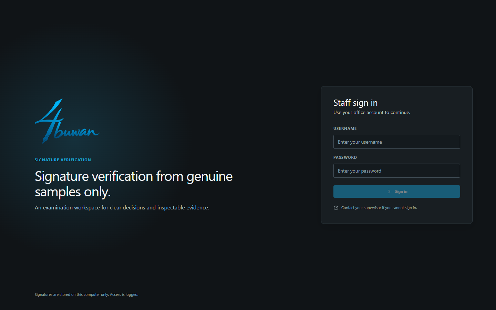
  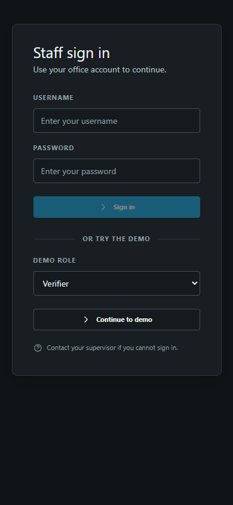
</td>
</tr>
<tr>
<td width="50%" valign="middle">

### 대시보드

준비된 프로필, 기록된 검증, 불확실 비율, 결정 대기 중인 검증, 최근 검증과 검토 대기열을 한눈에 봅니다.

</td>
<td width="50%">
  
  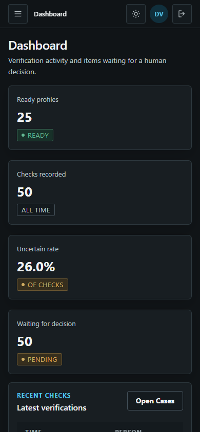
</td>
</tr>
<tr>
<td width="50%" valign="middle">

### 검증과 근거

등록된 사람을 고르고 의심 서명을 추가하면 신뢰도 표시와 불확실 구간이 있는 참고 판정을 받습니다. 전체 분석 근거가 같은 스크롤 페이지에 있고, 수동 비교 도구도 함께 있습니다.

</td>
<td width="50%">
  
  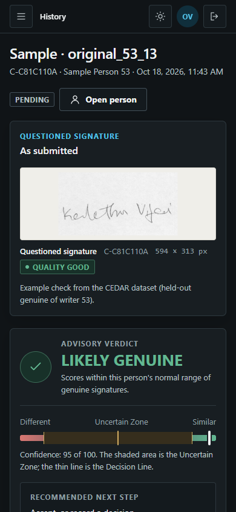
</td>
</tr>
<tr>
<td width="50%" valign="middle">

### 사람 등록

4단계 마법사: 사람 정보, 각각 즉시 품질을 확인하는 진짜 서명 12개, 이미지 정리 미리보기, 그리고 서명 프로필. 위조 샘플은 전혀 필요 없습니다.

</td>
<td width="50%">
  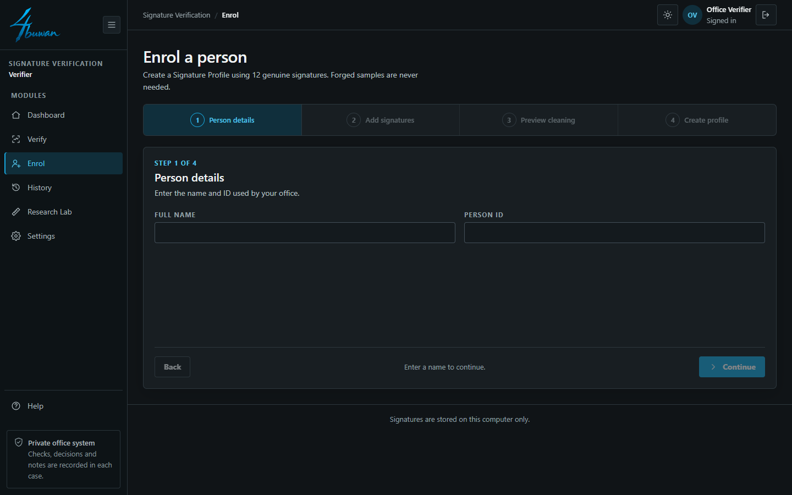
  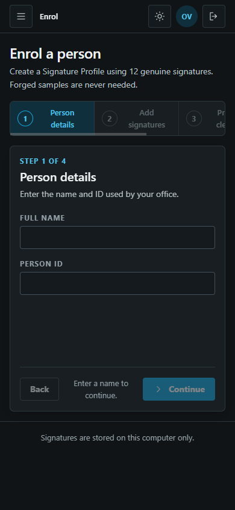
</td>
</tr>
<tr>
<td width="50%" valign="middle">

### 기록과 검토 대기열

저장된 모든 검증을 필터, 검색, CSV 내보내기로 다룹니다. 불확실하거나 결정되지 않은 검증은 사람의 결정, 이유, 시간 기록 메모를 기다리며 검토 대기열에 들어갑니다. 일괄 검사로 여러 서명을 한 번에 처리합니다.

</td>
<td width="50%">
  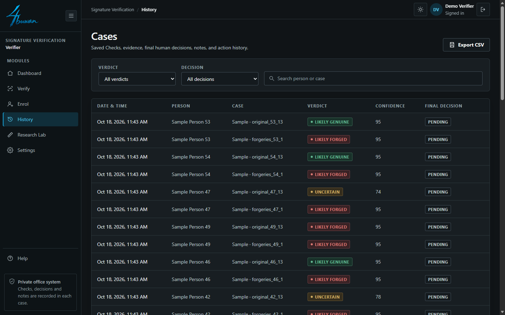
  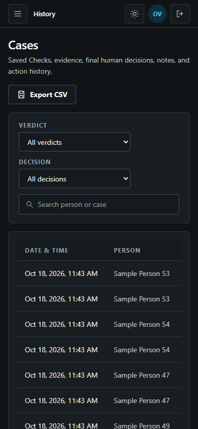
</td>
</tr>
<tr>
<td width="50%" valign="middle">

### 근거 보고서

저장된 사례로 다시 만드는 인쇄용 보고서: 의심 서명, 참조 12개, 판정, 판정선 대비 점수, 기록된 결정. 인쇄 대화상자에서 PDF로 저장할 수 있습니다.

</td>
<td width="50%">
  
  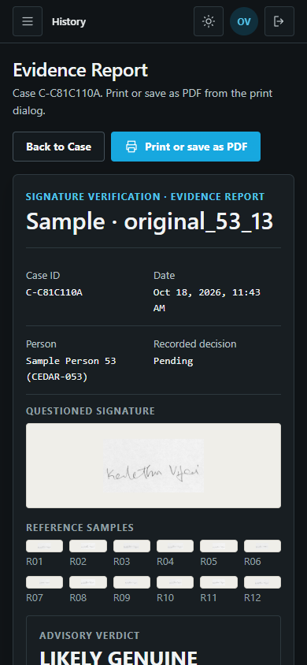
</td>
</tr>
<tr>
<td width="50%" valign="middle">

### 연구실

CEDAR, 벵골어, 힌디어에서 R1-WAW를 공유 기준과 표준 방법과 비교하고, 쉬운 말로 된 신뢰성 결론, 데이터셋 지름길 검사, 모델 카드를 보여 줍니다.

</td>
<td width="50%">
  
  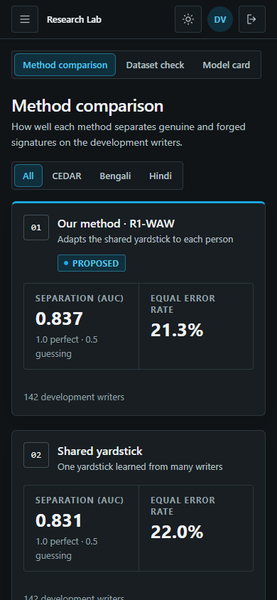
</td>
</tr>
<tr>
<td width="50%" valign="middle">

### 설정과 테마

기관 이름과 로고, 사람과 ID를 부르는 말, 검사 엄격도, 불확실 구간, 백업. 라이트와 다크 테마가 있으며, 로그인 화면은 항상 다크입니다.

</td>
<td width="50%">
  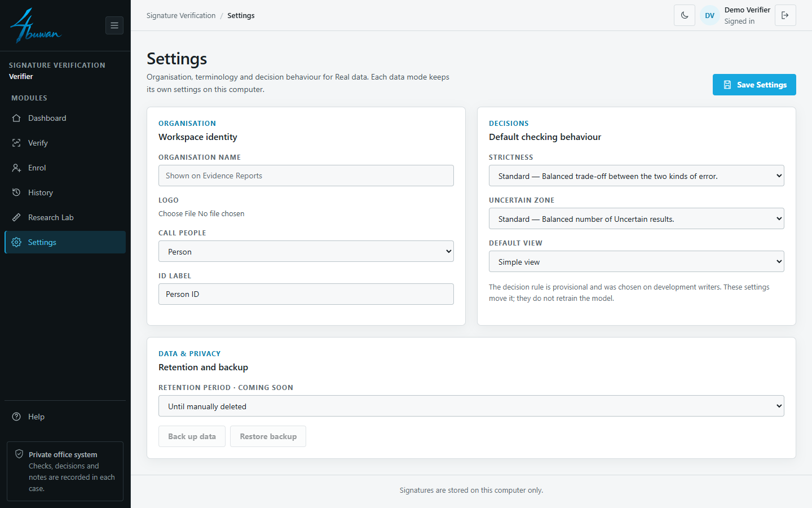
  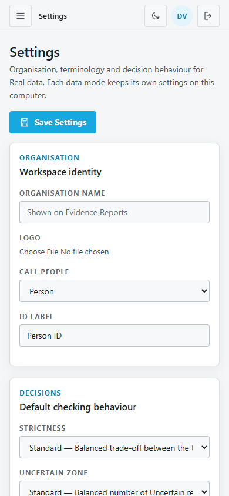
</td>
</tr>
<tr>
<td width="50%" valign="middle">

### 감독자와 연구자 데모

검토 대기열, 직원 계정, 방법 비교, 데이터셋 검사의 데모 화면. 노란 DEMO 막대로 표시되며, 모델이나 저장된 데이터를 쓰지 않습니다.

</td>
<td width="50%">
  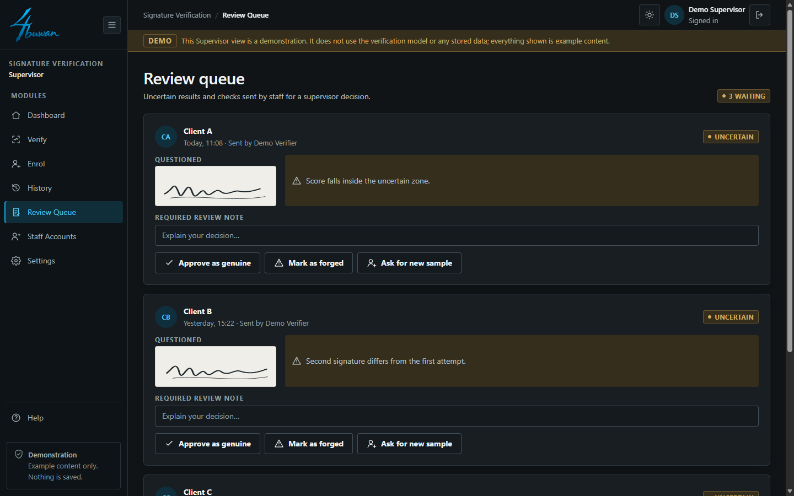
  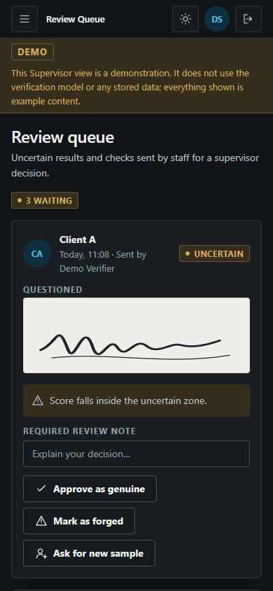
</td>
</tr>
</table>

---

## 모델 기능

작성자 종속 오프라인 서명 검증. 각 작성자는 **진짜 서명 12개만으로, 위조 서명 없이** 등록됩니다.

### 파이프라인

| 단계 | 방법 | 세부 사항 |
|---|---|---|
| 전처리 | 반전 → Otsu 배경 제거 → 자르기 → 패딩 → 크기 조정 | 100 × 100 px |
| 기술자 | HOG | 서명당 2,916차원 |
| 표현 | 쌍별 차이 | 쌍마다 17개의 차이 척도, 작성자당 진짜 쌍 66개 |
| 정규화 | 척도별 스케일 | 개발 작성자 전체의 전형적 크기 기준 |
| 거리 척도 | 랭크 1 작성자 적응 공분산 (J) | 공유 화이트닝(G)을 주방향을 따라 적응 |
| 분류기 | One-class SVM | 진짜 쌍으로만 학습, 모든 작성자에 동일한 설정 |
| 점수 | SVM 출력의 평균 | 테스트 서명을 12개 참조 서명 모두와 쌍으로 비교 |

### 거리 척도

공유 척도 `W_G`는 작성자 전체에서 합친 작성자 내 공분산으로 17개 척도를 화이트닝합니다. J는 주방향 `u₁`을 따라 합친 분산 대신 작성자 자신의 분산 `σ`를 사용하며, 나머지 방향은 모두 공유됩니다.

```math
W_J = W_G + \left(\sigma^{-1} - \lambda_1^{-1/2}\right) u_1 u_1^{\top}
```

작성자당 파라미터가 하나뿐이므로 참조 서명 12개로 충분히 추정할 수 있습니다.

| 코드 | 거리 척도 | 작성자당 파라미터 |
|---|---|---|
| B | 전역 대각 | 0 |
| G | 통합 전체 공분산 | 0 |
| **J** | **랭크 1 작성자 적응** | **1** |

### 데이터셋

| 데이터셋 | 문자 | 개발 작성자 |
|---|---|---|
| CEDAR | 라틴 문자 | 25 |
| BHSig260 Bengali | 벵골 문자 | 45 |
| BHSig260 Hindi | 데바나가리 | 72 |

등록: 진짜 1–12. 테스트: 진짜 13–24와 위조 1–12. 172명의 작성자는 단 한 번의 최종 평가를 위해 보류되어 있습니다.

### 결과 (개발 세트, 작성자 142명)

| 거리 척도 | AUC | EER |
|---|---|---|
| B — 전역 대각 | 0.772 | 25.8% |
| G — 통합 전체 공분산 | 0.831 | 22.0% |
| **J — 랭크 1 작성자 적응** | **0.837** | **21.3%** |

| 데이터셋 | J AUC | J EER |
|---|---|---|
| CEDAR | 0.839 | 21.3% |
| BHSig260 Bengali | 0.801 | 25.4% |
| BHSig260 Hindi | 0.858 | 18.8% |

작성자 단위 대응 비교로 Wilcoxon 검정, Holm 보정, 부트스트랩 구간을 사용. J 대비 G: AUC +0.006 (개선 53명, 악화 13명, 변화 없음 76명).

> **상태:** 초안. 결과는 개발 작성자에 대한 것뿐이며, 보류 세트 평가는 아직 수행하지 않았습니다. 벵골어에서는 이미지 통계 대조군이 모델과 비슷한 성능을 보이므로 벵골어 결과는 서명 검증으로 보고하지 않습니다.

---

## 라이선스

4buwan은 [MIT 라이선스](../../LICENSE)에 따른 무료 오픈 소스입니다.


