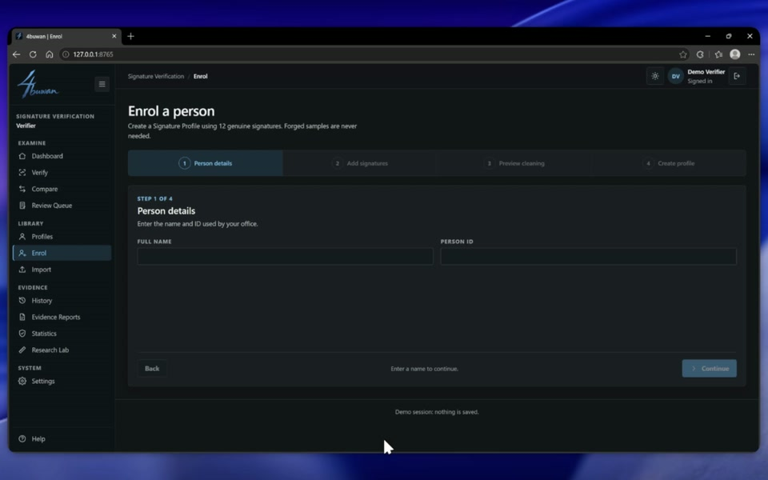
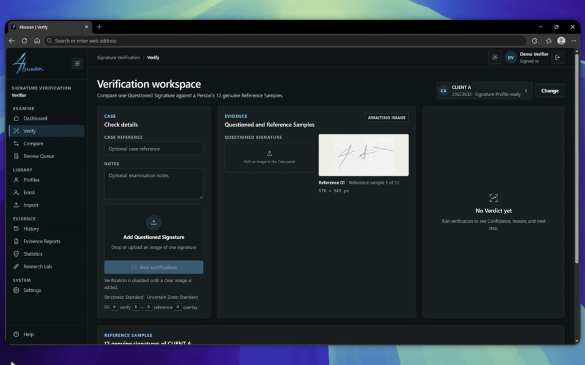
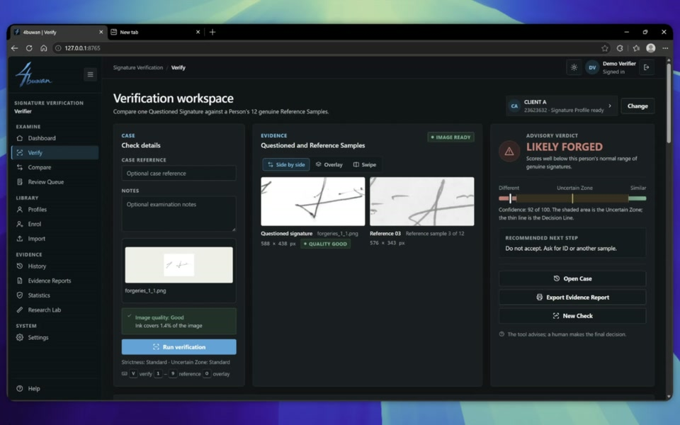
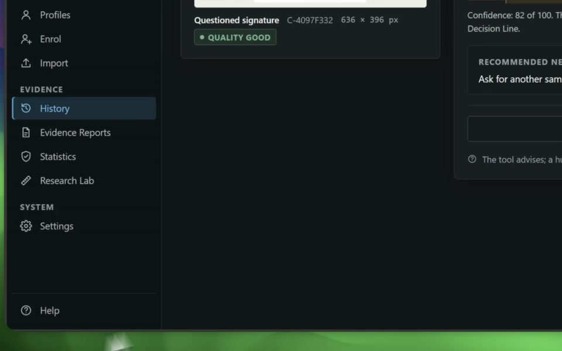
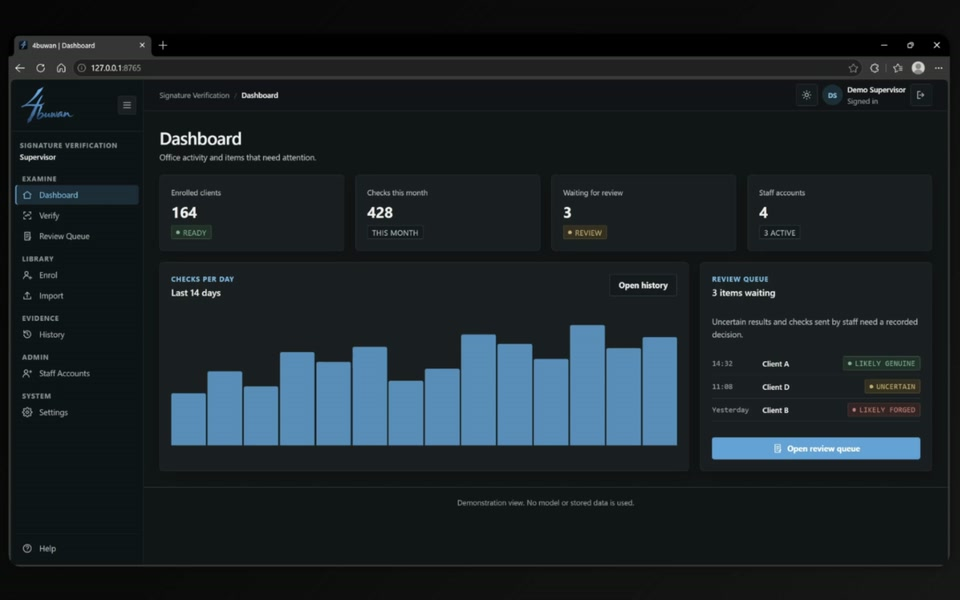
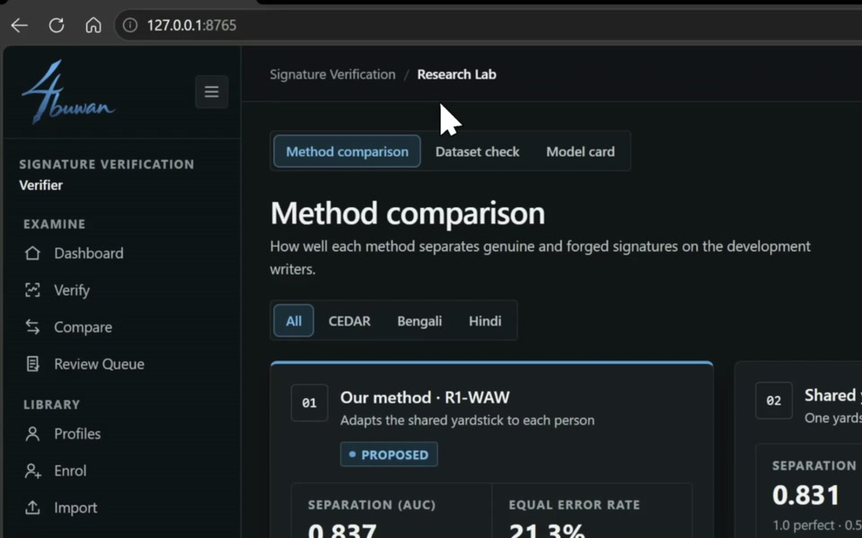
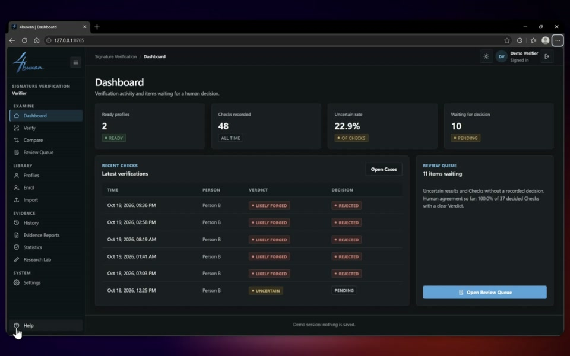

<h1 align="center">
   4buwan
</h1>

  
  
  

  <a href="../../README.md">English</a> · <a href="README.zh-CN.md">中文</a> · <a href="README.ja.md">日本語</a> · <a href="README.ko.md">한국어</a> · <a href="README.es.md">Español</a> · <a href="README.fr.md">Français</a> · Português · <a href="README.tl.md">Tagalog</a>

  <strong>Verificação de assinaturas apenas a partir de amostras genuínas.</strong> 
  Um espaço de exame para decisões claras e evidências verificáveis.

  

## Funcionalidades do sistema

<table>
<tr>
<td width="50%" valign="middle">

### Cadastro só com assinaturas genuínas

Doze assinaturas genuínas formam um perfil, cada uma conferida assim que chega. Falsificações nunca são necessárias.

[Vídeo completo →](../mp4/Genuine-Only%20Enrolment.mp4)

</td>
<td width="50%">
  <a href="../mp4/Genuine-Only%20Enrolment.mp4"><picture><source srcset="../gif/genuine-only-enrolment.gif" type="image/gif"></picture></a>
</td>
</tr>
<tr>
<td width="50%" valign="middle">

### Verificação adaptada a cada pessoa

O R1-WAW ajusta uma medida compartilhada à variação própria de cada pessoa e dá um veredito consultivo com zona incerta.

[Vídeo completo →](../mp4/Writer-Adaptive%20Verification.mp4)

</td>
<td width="50%">
  <a href="../mp4/Writer-Adaptive%20Verification.mp4"><picture><source srcset="../gif/writer-adaptive-verification.gif" type="image/gif"></picture></a>
</td>
</tr>
<tr>
<td width="50%" valign="middle">

### Evidência inspecionável

Cada veredito mostra o raciocínio: a pontuação diante da linha de decisão, as 12 comparações, as 17 medidas e a matriz de similaridade.

[Vídeo completo →](../mp4/Inspectable%20Evidence.mp4)

</td>
<td width="50%">
  <a href="../mp4/Inspectable%20Evidence.mp4"><picture><source srcset="../gif/inspectable-evidence.gif" type="image/gif"></picture></a>
</td>
</tr>
<tr>
<td width="50%" valign="middle">

### Relatórios de evidências para impressão

Com um clique, um caso vira um relatório pronto para arquivo: a assinatura questionada, as 12 referências, o veredito e a pontuação. Imprima ou salve em PDF.

[Vídeo completo →](../mp4/Printable%20Evidence%20Reports.mp4)

</td>
<td width="50%">
  <a href="../mp4/Printable%20Evidence%20Reports.mp4"><picture><source srcset="../gif/printable-evidence-reports.gif" type="image/gif"></picture></a>
</td>
</tr>
<tr>
<td width="50%" valign="middle">

### Revisão com decisão humana

A ferramenta aconselha, uma pessoa decide. Verificações incertas aguardam numa fila de revisão, e toda decisão exige um motivo.

[Vídeo completo →](../mp4/Human%20Decision%20Review.mp4)

</td>
<td width="50%">
  <a href="../mp4/Human%20Decision%20Review.mp4"><picture><source srcset="../gif/human-decision-review.gif" type="image/gif"></picture></a>
</td>
</tr>
<tr>
<td width="50%" valign="middle">

### Laboratório de pesquisa e Checagem de atalhos

A tese dentro do app: comparação de métodos, checagem de atalhos do conjunto de dados e o cartão do modelo. Prova que o método lê a escrita, e não o scanner. Cada resultado é comparado a um controle que só vê características simples da imagem.

[Vídeo completo →](../mp4/Research%20Lab.mp4)

</td>
<td width="50%">
  <a href="../mp4/Research%20Lab.mp4"><picture><source srcset="../gif/research-lab.gif" type="image/gif"></picture></a>
</td>
</tr>
<tr>
<td width="50%" valign="middle">

### Painel do escritório

Perfis, verificações, taxa de incertos e decisões pendentes num relance.

[Vídeo completo →](../mp4/Office%20Dashboard.mp4)

</td>
<td width="50%">
  <a href="../mp4/Office%20Dashboard.mp4"><picture><source srcset="../gif/office-dashboard.gif" type="image/gif"></picture></a>
</td>
</tr>
</table>

**Também incluído:**

- **Comparar** — Examine de duas a seis assinaturas lado a lado.
- **Importar e exportar** — Carregue um espaço de trabalho inteiro (pessoas, assinaturas, verificações e decisões) a partir de um único arquivo.
- **Histórico e exportação CSV** — Cada verificação, decisão e nota, pesquisável.
- **Temas claro e escuro** — Com um layout que funciona do celular ao computador.
- **Privado por padrão** — As assinaturas ficam neste computador.

---

## Funcionalidades do modelo

Verificação offline de assinaturas dependente do escritor. Cada escritor é cadastrado com **12 assinaturas genuínas e nenhuma falsificação**.

### Método (resumo)

As assinaturas são comparadas em pares. Um modelo aprendido apenas com os pares genuínos do escritor pontua uma assinatura questionada contra as 12 referências. O núcleo do método, **R1-WAW** (branqueamento adaptativo ao escritor de posto um), ajusta a cada escritor uma medida compartilhada por muitos escritores com um único parâmetro, então 12 referências bastam para estimá-lo.

A implementação não é publicada: o motor de verificação é distribuído compilado (`backend/sigdesk_engine/engine.pyc`, Python 3.14).

### Conjuntos de dados

| Conjunto | Escrita | Escritores de desenvolvimento |
|---|---|---|
| CEDAR | Latina | 25 |
| BHSig260 Bengali | Bengali | 45 |
| BHSig260 Hindi | Devanágari | 72 |

Cadastro: genuínas 1–12. Teste: genuínas 13–24 e falsificações 1–12. 172 escritores estão reservados para uma única avaliação final.

### Resultados (conjunto de desenvolvimento, 142 escritores)

| Métrica | AUC | EER |
|---|---|---|
| B — Diagonal global | 0.772 | 25.8% |
| G — Covariância completa agrupada | 0.831 | 22.0% |
| **J — Adaptativa ao escritor de posto 1** | **0.837** | **21.3%** |

| Conjunto | J AUC | J EER |
|---|---|---|
| CEDAR | 0.839 | 21.3% |
| BHSig260 Bengali | 0.801 | 25.4% |
| BHSig260 Hindi | 0.858 | 18.8% |

Comparação pareada por escritor com testes de Wilcoxon, correção de Holm e intervalos bootstrap. J versus G: +0,006 de AUC (53 escritores melhoraram, 13 pioraram, 76 sem mudança).

> **Status:** rascunho. Os resultados são apenas dos escritores de desenvolvimento; a avaliação reservada ainda não foi executada. Em bengali, um controle baseado em estatísticas de imagem empata com o modelo, por isso esses resultados não são apresentados como verificação de assinaturas.

---

## Licença

4buwan é software livre e de código aberto sob a [Licença MIT](../../LICENSE).

