<h1 align="center">
   4buwan
</h1>

  
  
  

  <a href="../../README.md">English</a> · <a href="README.zh-CN.md">中文</a> · <a href="README.ja.md">日本語</a> · <a href="README.ko.md">한국어</a> · <a href="README.es.md">Español</a> · <a href="README.fr.md">Français</a> · <a href="README.pt.md">Português</a> · Tagalog

  <strong>Pagpapatunay ng pirma gamit lamang ang mga tunay na sample.</strong> 
  Isang workspace sa pagsusuri para sa malinaw na desisyon at ebidensiyang masusuri.

  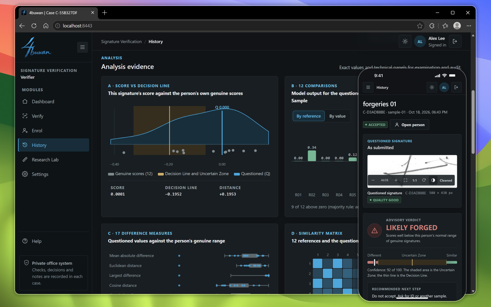

## Mga Feature ng Sistema

<table>
<tr>
<td width="50%" valign="middle">

### Pag-enroll Gamit ang Tunay na Pirma Lamang

Labindalawang tunay na pirma ang bumubuo ng profile, at sinusuri ang kalidad ng bawat isa pagdating. Hindi kailanman kailangan ng pineke.

</td>
<td width="50%">
  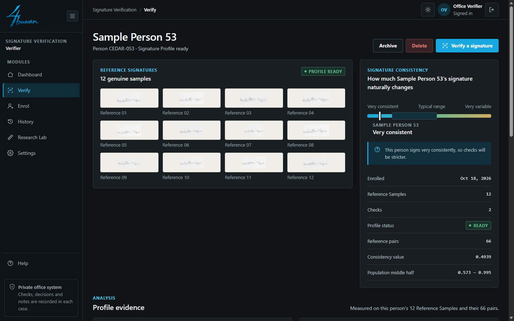
</td>
</tr>
<tr>
<td width="50%" valign="middle">

### Pagpapatunay na Umaangkop sa Sumulat

Iniaangkop ng R1-WAW ang iisang shared na panukat sa sariling pagbabago ng pirma ng bawat tao, saka nagbibigay ng payong hatol na may uncertain zone.

</td>
<td width="50%">
  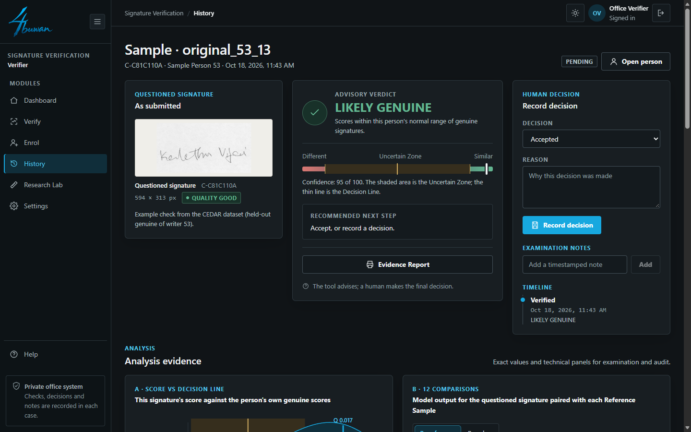
</td>
</tr>
<tr>
<td width="50%" valign="middle">

### Ebidensiyang Masusuri

Ipinapakita ng bawat hatol ang batayan nito: ang score laban sa decision line, lahat ng 12 paghahambing, ang 17 sukat at ang similarity matrix.

</td>
<td width="50%">
  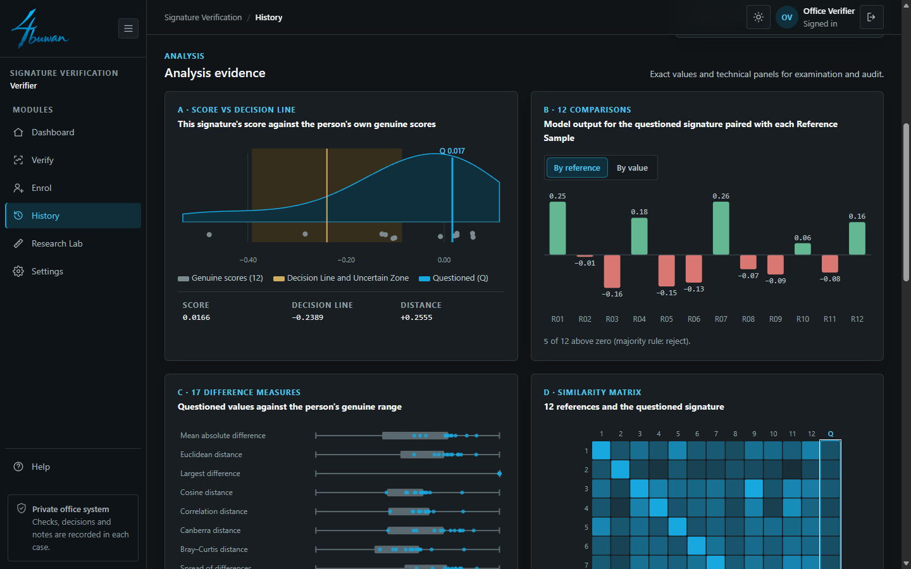
</td>
</tr>
<tr>
<td width="50%" valign="middle">

### Printable na Evidence Report

Isang click lang, nagiging ulat ang isang kaso: ang pirmang sinusuri, lahat ng 12 reference, ang hatol at ang scoring. I-print o i-save bilang PDF.

</td>
<td width="50%">
  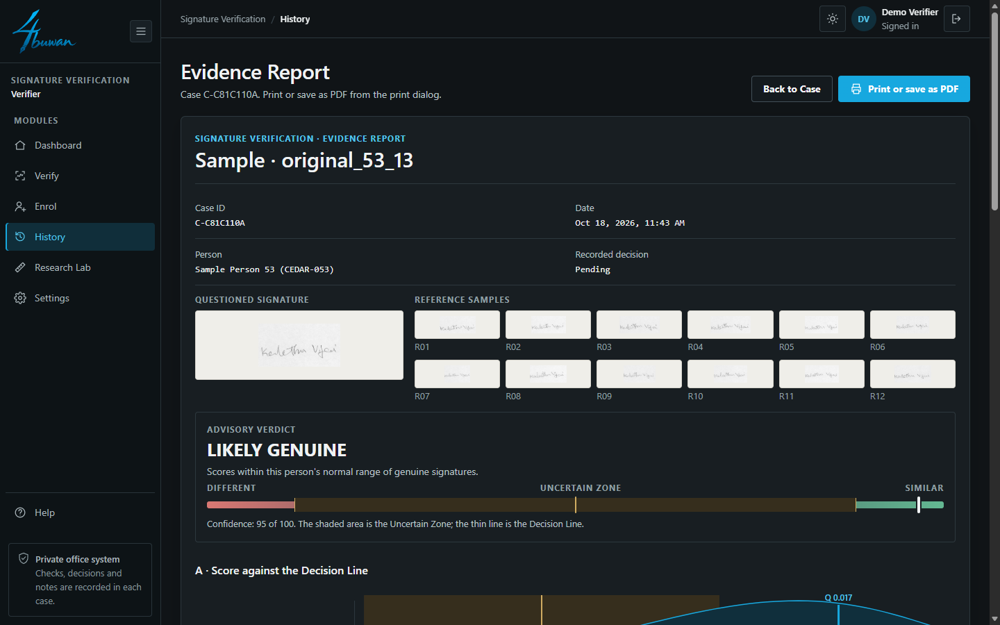
</td>
</tr>
<tr>
<td width="50%" valign="middle">

### Review ng Desisyon ng Tao

Nagpapayo ang tool, tao ang nagdedesisyon. Naghihintay sa review queue ang mga uncertain na pagsusuri, at kailangan ng dahilan ang bawat desisyon.

</td>
<td width="50%">
  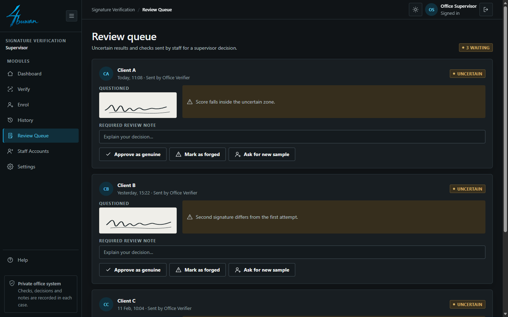
</td>
</tr>
<tr>
<td width="50%" valign="middle">

### Research Lab

Ang thesis sa loob ng app: paghahambing ng paraan, dataset shortcut check at ang model card.

</td>
<td width="50%">
  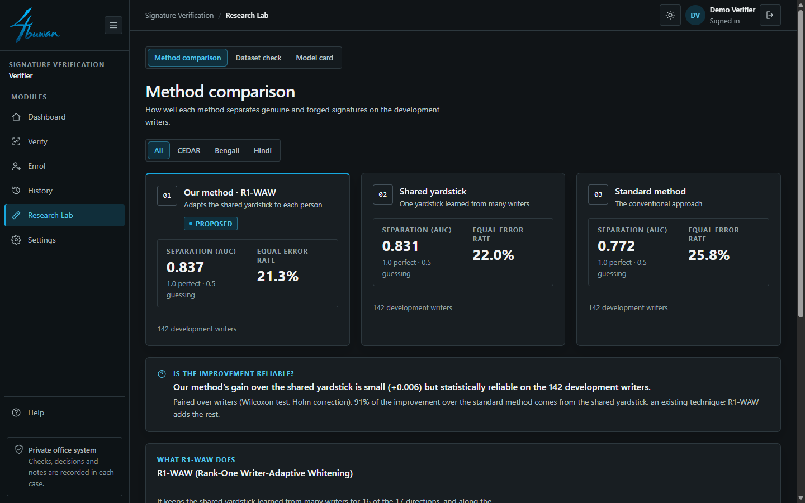
</td>
</tr>
<tr>
<td width="50%" valign="middle">

### Shortcut Check

Pinatutunayan na sulat-kamay ang binabasa ng paraan, hindi ang scanner. Sinusubok ang bawat resulta laban sa control na simpleng detalye lang ng larawan ang nakikita.

</td>
<td width="50%">
  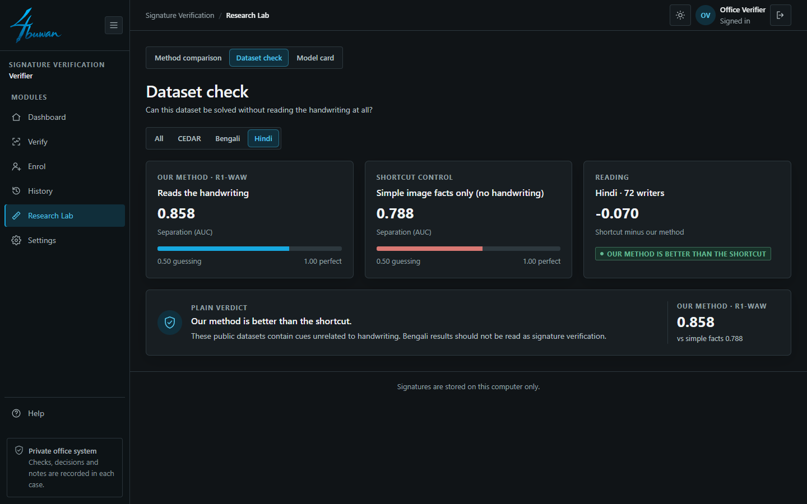
</td>
</tr>
<tr>
<td width="50%" valign="middle">

### Mga Role at Staff Account

Nagsusuri ang Verifier, nagdedesisyon at namamahala ng staff ang Supervisor, pinag-aaralan ng Researcher ang paraan. Tanging kailangang module lang ang nakikita ng bawat role.

</td>
<td width="50%">
  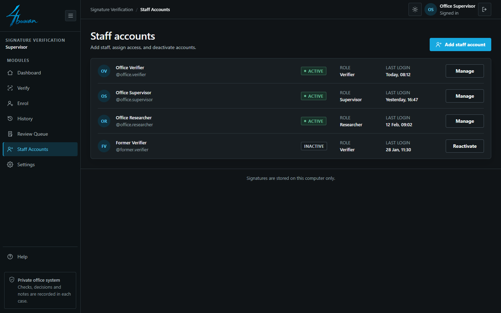
</td>
</tr>
<tr>
<td width="50%" valign="middle">

### Dashboard ng Opisina

Mga profile, pagsusuri, uncertain rate at mga nakabinbing desisyon sa isang tingin.

</td>
<td width="50%">
  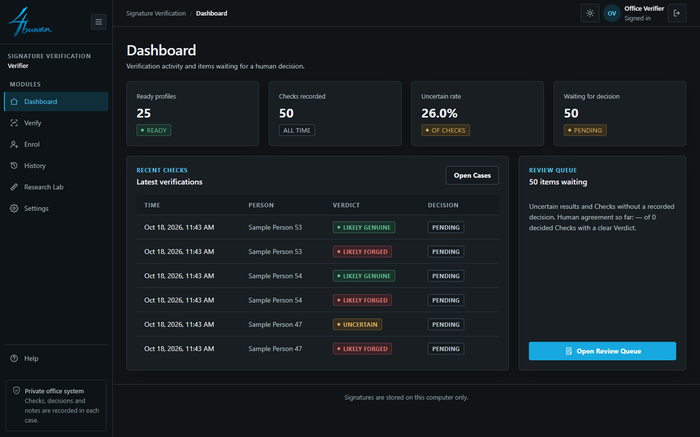
</td>
</tr>
</table>

**Kasama rin:**

- **Compare** — Suriin ang dalawa hanggang anim na pirma nang magkatabi.
- **Batch Check** — Patunayan ang maraming pirma nang sabay-sabay.
- **History at CSV Export** — Bawat pagsusuri, desisyon at tala, nahahanap.
- **Light at Dark na Theme** — May layout na gumagana mula phone hanggang desktop.
- **Pribado sa Disenyo** — Nananatili sa computer na ito ang mga pirma.

---

## Mga Feature ng Modelo

Offline na pagpapatunay ng pirma na nakadepende sa sumulat. Ang bawat sumulat ay ini-enroll gamit ang **12 tunay na pirma at walang pineke**.

### Paraan (buod)

Pinaghahambing ang mga pirma nang dala-dalawa. Isang modelong natuto lamang sa tunay na mga pares ng sumulat ang nagbibigay ng score sa pirmang sinusuri laban sa lahat ng 12 reference. Ang ubod ng paraan, ang **R1-WAW** (rank-one writer-adaptive whitening), ay iniaangkop sa bawat sumulat ang panukat na pinagsasaluhan ng maraming sumulat gamit ang iisang parameter, kaya sapat ang 12 reference para tantiyahin ito.

Hindi inilalathala ang implementasyon: naka-compile ang verification engine (`backend/sigdesk_engine/engine.pyc`, Python 3.14).

### Mga Dataset

| Dataset | Sulat | Development na sumulat |
|---|---|---|
| CEDAR | Latin | 25 |
| BHSig260 Bengali | Bengali | 45 |
| BHSig260 Hindi | Devanagari | 72 |

Enrolment: tunay 1–12. Test: tunay 13–24 at pineke 1–12. 172 sumulat ang nakareserba para sa iisang huling ebalwasyon.

### Mga Resulta (development set, 142 sumulat)

| Metric | AUC | EER |
|---|---|---|
| B — Global diagonal | 0.772 | 25.8% |
| G — Pinagsamang full covariance | 0.831 | 22.0% |
| **J — Rank-1 writer-adaptive** | **0.837** | **21.3%** |

| Dataset | J AUC | J EER |
|---|---|---|
| CEDAR | 0.839 | 21.3% |
| BHSig260 Bengali | 0.801 | 25.4% |
| BHSig260 Hindi | 0.858 | 18.8% |

Paired ayon sa sumulat gamit ang Wilcoxon test, Holm correction at bootstrap interval. J laban sa G: +0.006 AUC (53 sumulat ang gumanda, 13 ang lumala, 76 ang walang pagbabago).

> **Status:** draft. Mula lamang sa mga development na sumulat ang mga resulta; hindi pa naisasagawa ang ebalwasyon sa nakareserbang set. Sa Bengali, katumbas ng modelo ang control na batay sa image statistics, kaya hindi iniuulat ang resulta sa Bengali bilang pagpapatunay ng pirma.

---

## Lisensya

Ang 4buwan ay libre at open source sa ilalim ng [MIT License](../../LICENSE).

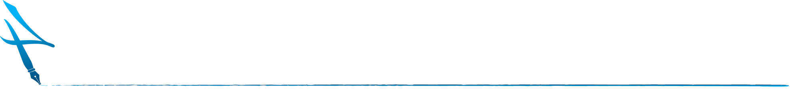
